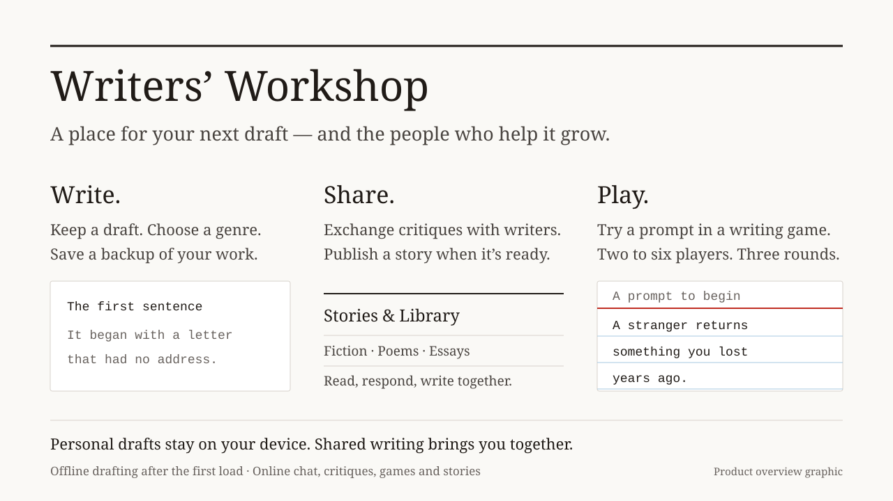

# Writers’ Workshop

**[Set up Writers’ Workshop](RUNNING.md)** · [Use on Mac or iPhone](RUNNING.md#install-the-hosted-app) · [Report a problem](https://github.com/gwilltsherman-byte/writers-workshop/issues/new)

Writers’ Workshop is my app for writing and finding readers. Keep a draft, publish stories, trade critiques, chat with other writers, or play a multiplayer writing game. Your personal draft stays on your device; shared drafts, stories and live activities use a PostgreSQL database and need an internet connection.

The hosted app is awaiting deployment while the Netlify team is paused. You can run it locally using the setup guide.



## Start writing

1. [Set up the app](RUNNING.md) and open it on your computer or phone.
2. Choose **Write** to start a draft, select genres and save a backup.
3. When you’re ready, publish a story, exchange a critique or try a writing game.

[Netlify deployment guide](DEPLOYMENT.md)

## Activities

- **Write:** keep a personal draft in your browser, choose genres, and publish
  it to Stories when signed in.
- **Write together:** create a shared draft and invite a partner by link.
  Updates are saved to the database. A version check prevents two simultaneous
  saves from silently overwriting each other.
- **Stories and Library:** read published stories, find your own work, and
  choose pieces for critique.
- **Live chat:** match with another writer, exchange messages, and return to
  the same conversation after reloading. The screen shows the latest 100
  messages; the database keeps the complete conversation.
- **Fast and long critique:** exchange pieces, send real feedback, and open
  a chat if both writers agree. Notes and session deadlines survive reloads.
- **The writing game:** two to six players, three rounds, generated prompts,
  saved drafts, submissions, voting, scores, rematches, and friend-room links.
  Two-player games let both writers vote. With more players, the audience
  votes; the two active writers sit out. A tied vote gives both writers a
  point. Rounds with no votes award no points.
- **Vocabulary:** practice with a public-domain Webster’s dictionary.

Guest players can enter chat, critique, games, and shared drafts without an
email account. Each browser tab gets a distinct signed guest session. Reloading
preserves it; closing the tab can end access to that guest identity. Sign in
for an account that can be used again on other devices.

## How live play works

Next.js route handlers synchronize the browsers with PostgreSQL. Active pages
check for changes about once a second; background tabs check less often.
PostgreSQL transactions serialize matchmaking and room updates across separate
Netlify function instances. Room access uses signed player identities rather
than a name supplied by the browser.

Deadlines are stored in the database. The next request advances an expired
writing or voting phase, so a match cannot depend on an in-memory timer or a
resident WebSocket server. A player who reconnects keeps their role and saved
piece. One vote is accepted per player per round, and stale votes cannot spill
into the following round.

Netlify hosts both the pages and the API. Netlify Database, or another
PostgreSQL database supplied through `DATABASE_URL`, stores accounts, stories,
messages and live rooms. Email signup and account email changes require SMTP;
guest multiplayer does not.

## Development and checks

Use Node.js 22 and PostgreSQL. Setup is in [RUNNING.md](RUNNING.md).

```sh
npm ci
npm run migrate:deploy
npm run dev
```

```sh
npm run lint
npm run typecheck
npm test
npm run build
npm run test:smoke
```

The integration tests create a temporary PostgreSQL database unless
`TEST_DATABASE_URL` is supplied. They exercise matchmaking, chat privacy and
persistence, critiques, complete two-player games, six-player matches, lobby
capacity, duplicate votes, timeouts, and conflicting shared-draft saves.
The production smoke test uses a local test mailbox; it does not send external
email. It checks signup, verification, login, story publication, library,
vocabulary, guest sessions, chat and private history.
